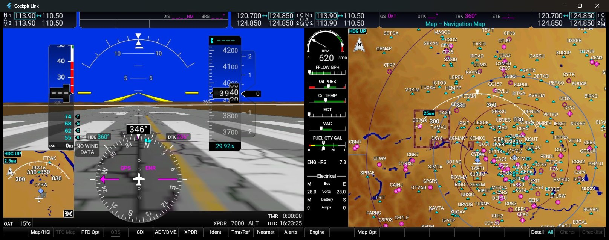
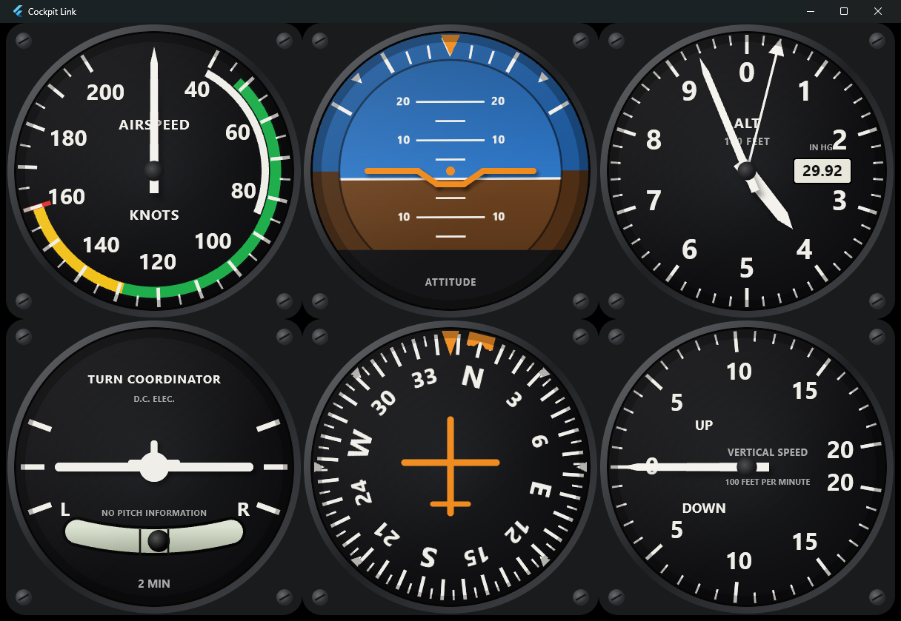
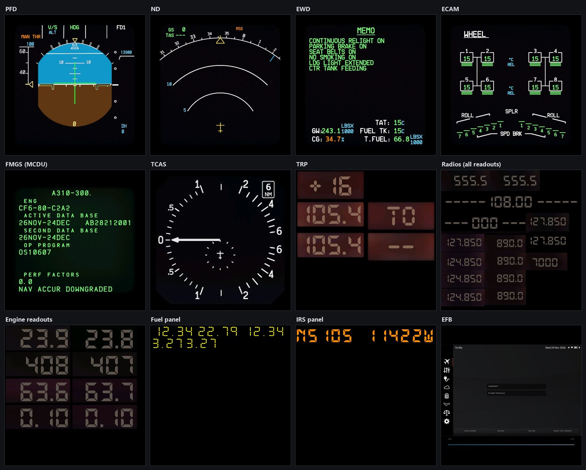

# Cockpit Link

**Put your sim's cockpit displays on real screens.** Cockpit Link streams the glass displays of
Microsoft Flight Simulator 2024 (for example the G1000 PFD and MFD) from the sim PC to small monitors
driven by another device on your network: a mini PC, a Raspberry Pi, a tablet or a phone. For aircraft
with classic round dials it draws the steam gauges itself, from live sim data.

- **No pop-out windows.** The displays come straight out of the sim's own rendering, so you do not
  have to pop panels out, move windows around or give up a monitor on the sim PC.
- **Glass or steam, picked by itself.** In a glass cockpit the screens show the displays. In a
  steam-gauge aircraft they show gauge layouts you design in a web editor.
- **No keyboard on the display box.** The client finds the host on the network by itself, can start
  at sign-in in full screen, and shows whatever the host assigns to its screen.
- **One-way and read-only.** Nothing is sent back to the sim.

> **Status: early, MSFS 2024 only.** Tested with MSFS 2024 (Steam edition, DirectX 12) in the default
> Cessna 172 G1000 (glass) and Cessna 152 (steam). Other aircraft's displays are learned when
> you fly them ([Other aircraft](#other-aircraft-and-displays)). MSFS 2020 and DirectX 11 are not supported.

## Support Cockpit Link

Cockpit Link is free and open source, made in spare time. If it makes your cockpit better, you can buy
me a coffee on Ko-fi. It helps keep it working after every sim update.

[](https://ko-fi.com/richardludvigh)

## Screenshots

| Glass: G1000 PFD and MFD from the sim | Steam: gauges drawn from live sim data |
|---|---|
|  |  |
| **Both in one layout:** the G1000 engine strip next to steam gauges | **Learned by itself:** every A310 display, on first load |
|  |  |

**[More screenshots](docs/screenshots.md):** the TBM 930 and 737 MAX, the layout editor and its Insert window, the
monitor page.

## How it works

```
 Sim PC (Windows)                                                      Display devices (LAN)
 ┌─────────────────────────────────────────────────────────┐
 │ MSFS 2024                                               │
 │  ├ Community hook ── marks each display, reports layout ─┼─┐
 │  └ capture.dll (injected) ── copies display textures ────┼─┤ named pipe / local WebSocket
 │ SimConnect ── flight state, gauge data ──────────────────┼─┤
 │                                                         │ ▼
 │ Host (Node.js) ── JPEG frames + gauge data + layouts ────┼───────► Client app (Flutter)
 │   web: monitor page, layout editor                      │ WebSocket  Windows / Linux / Pi /
 └─────────────────────────────────────────────────────────┘ + mDNS     macOS / Android
```

1. **Community hook** (`hook/`). A small Community package that adds a few lines to the sim's
   instrument base script. It tells the host which instruments each cockpit has, and the host learns
   the glass displays among them. On each display it paints two marker pixels in a colour unique to
   that display, and reports to the host where the display sits on the page.
2. **capture.dll** (`capture/`, C++). The host injects it into the sim once a flight is live. It hooks
   DirectX 12, finds the textures that carry the marker pixels, copies them without stalling the GPU,
   encodes them as JPEG on its own threads and sends them to the host over a named pipe. It only copies
   displays that someone is watching. Measured cost on the sim's render thread: about 0.02 ms per frame.
3. **Host** (`host/`, Node.js). Runs on the sim PC and does the following:
   - starts the injection;
   - reads flight data over SimConnect;
   - decides per screen whether to show glass or steam;
   - serves frames, gauge data and layouts to the clients over WebSocket;
   - advertises itself on the network with mDNS.

   It also has two web pages: a debug monitor and the layout editor.
4. **Client app** (`client/`, Flutter). It shows glass displays and draws the steam gauges at up to
   60 fps, with interpolation between data samples. It can run several windows, one per monitor.

## Requirements

**Sim PC**
- Windows 10/11 x64, MSFS 2024 running on DirectX 12. Tested with the Steam edition; the MS Store
  edition should work but has not been tried.
- [Node.js](https://nodejs.org) 20 or newer.
- To build the C++ parts: Visual Studio 2022 (or its Build Tools) with *Desktop development with C++*,
  which includes CMake.

**Display device**, any of:
- **Windows 10/11 PC.** Recommended for a two-monitor box: an old office mini PC with two video outputs
  works well.
- **Linux PC or Raspberry Pi 4/5** (64-bit OS, desktop session).
- **macOS.**
- **Android** tablet or phone.

## Install (Windows)

Download from the Releases page:

- **Sim PC:** `CockpitLink-Host-<version>-Setup.exe`. It installs the host for your Windows user (no admin
  rights needed), with its own copy of Node.js, so there is nothing else to install. Close MSFS first:
  setup also builds and installs the Community hook from your sim's own files. Then start
  **Cockpit Link** from the Start menu. It runs as a tray icon, with no console window. Ticking
  "Start when I sign in" during setup starts it with Windows.
- **Display PCs:** `CockpitLink-Client-<version>-Setup.exe`, or the portable
  `CockpitLink-Client-<version>-windows.zip` (unzip anywhere and run `cockpit_link.exe`). Both include
  the Visual C++ runtime. For Linux, macOS and Android, see [Client app](#client-app).

After every MSFS update, run **Repair Community hook** from the Start menu (sim closed): the hook
contains a copy of a sim file that updates change. Uninstalling removes the program and the hook, and
asks whether to keep your learned displays and layouts.

To build from source instead, follow the quick start below.

## Quick start (from source)

### 1. Build the sim-PC parts

From a *Developer Command Prompt for VS 2022* (or any prompt where `cmake` is on the PATH):

```
cmake -S capture -B capture/build -G "Visual Studio 17 2022" -A x64
cmake --build capture/build --config Release

cmake -S injector -B injector/build -G "Visual Studio 17 2022" -A x64
cmake --build injector/build --config Release

cmake -S tray -B tray/build -G "Visual Studio 17 2022" -A x64
cmake --build tray/build --config Release

cd host
npm install
```

### 2. Install the Community hook (sim closed)

```
node hook/build-hook.mjs      # stock BaseInstrument.js + our hook -> hook/dist/
node hook/install-hook.mjs    # copies it into the Community folder
```

`build-hook.mjs` looks for the stock file in the default Steam install. For other locations, such as
the MS Store version or a custom drive, pass it:
`--stock "<sim folder>\Packages\asobo-vcockpits-instruments\html_ui\Pages\VCockpit\Instruments\Shared\BaseInstrument.js"`.
`install-hook.mjs` finds the Community folder from the sim's `UserCfg.opt`; set `MSFS_COMMUNITY` to
override it.

**Rebuild and reinstall the hook after every sim update**, because it contains a copy of a sim file.
Only one Community package can replace that file, so the installer refuses if another package already
does (`--force` installs anyway). To uninstall: `node hook/install-hook.mjs --remove`.

### 3. Run the host

```
cd host
npm start
```

On first start, allow Node.js through the Windows firewall on **private** networks, or other devices will
not reach it. Open `http://localhost:8800/` for the monitor page.

While the host runs, its icon (a small round gauge) sits in the system tray:

- **Click** it to open the layout editor; **right-click** for the monitor, the current state and *Quit*.
- **Ring colour:** grey = host running, blue = sim running, green = glass displays being captured.
  Hover for details.
- Windows 11 puts new tray icons under the **^** arrow at first. To keep it visible, drag it onto the
  taskbar, or turn it on in *Settings > Personalization > Taskbar > Other system tray icons*.
- The tooltip says **Streaming** (only what client screens show is captured) or **Setup** (an editor or
  monitor page is open and visible, so previews are captured too). It switches by itself: a hidden or
  minimised editor or monitor tab costs the sim nothing.
- The icon closes when the host stops. It needs `tray/build` (step 1); without it the host runs as
  before, with no icon.

Start the sim and load a flight. About 10 seconds after the flight is live, the host loads capture.dll
into the sim, once per sim session. The monitor page then shows the displays.

### 4. Run a client

Build the client (see [Client app](#client-app)) and start it on the display device. On the **Settings**
page:

1. **Host.** Leave it on *Find automatically*, or type the sim PC's address.
2. **Windows on this device.** Add one window per monitor. For each, pick the monitor, what it shows
   and whether it is full screen. *Screen 1* and *Screen 2* follow the host: the PFD and MFD in a glass
   cockpit, the steam layouts otherwise.
3. **Startup.** Turn on *Start when I sign in* and *Open the windows straight away* for a box without a
   keyboard.
4. Press **Save and start**. Tap or click a display to get back to Settings.

## Client app

Install the [Flutter SDK](https://docs.flutter.dev/get-started/install) (stable channel; this project uses
3.50) and run `flutter doctor` to see what else your platform needs. Then:

```
cd client
flutter pub get
```

### Windows

- Visual Studio 2022 with *Desktop development with C++*.
- Turn on **Developer Mode** (Settings > System > For developers), which Flutter needs for plugins.

```
flutter build windows
```

Output: `build\windows\x64\runner\Release\` (about 28 MB). Copy the **whole folder** to the display PC and
run `cockpit_link.exe`: the .exe needs the DLLs and the `data` folder next to it. Nothing is installed.

The display PC needs the Microsoft Visual C++ runtime, which most Windows PCs already have. If the app
complains about a missing `MSVCP140.dll` or `VCRUNTIME140.dll`, install the *Microsoft Visual C++
Redistributable (x64)* from Microsoft.

### Linux (PC or Raspberry Pi)

Build on the device itself. Flutter does not cross-compile Linux desktop apps, so for a Pi, build on the
Pi with a 64-bit OS.

```
sudo apt install clang cmake ninja-build pkg-config libgtk-3-dev liblzma-dev libstdc++-12-dev
flutter build linux
```

Output: `build/linux/x64/release/bundle/` (`arm64` on a Pi). Run `cockpit_link` from that folder.

- Host discovery uses mDNS and shares port 5353 with `avahi-daemon` if it is running.
- For a kiosk box: set the desktop to log in automatically and turn off screen blanking. Then turn on
  *Start when I sign in* in the app, which writes `~/.config/autostart/cockpit-link.desktop`.

### macOS

- Install Xcode and CocoaPods.

```
flutter build macos
```

Output: `build/macos/Build/Products/Release/cockpit_link.app`. The app is not sandboxed, because it
starts extra copies of itself for extra windows and writes a LaunchAgent for start at sign-in. It is not
signed: on first start, right-click it and choose Open.

### Android

```
flutter build apk
```

Install `build/app/outputs/flutter-apk/app-release.apk`. Some phones and tablets drop the multicast
packets mDNS uses. If the host is not found, type its address in Settings.

### iOS

Not tested. The project builds with Xcode (`flutter build ios`). Automatic discovery needs Apple's
multicast permission, so type the host address in Settings.

### Command line (optional)

Everything can be set on the Settings page. Flags override the saved settings for one run (one window),
which is useful for scripts and kiosks:

```
cockpit_link --screen 1                      follow the host's screen 1 (finds the host by itself)
cockpit_link --displays pfd,mfd              show these glass displays side by side
cockpit_link --layout six-pack               show this gauge layout
  --host 192.168.1.50  --port 8800           host address (default: find it on the network)
  --monitor 2  --fullscreen | --windowed     which monitor (number as listed in Settings)
  --split auto|row|column  --fps 30          layout of several displays, frame rate limit
  --name "Cockpit left"                      name shown to the host
  --profile left                             keep separate saved settings for this copy
```

## Layouts: steam gauges and glass displays together

Open `http://<sim PC>:8800/editor` in a browser. It is also linked from the monitor page.

- **Layouts.** Place, resize and configure items. **Insert gauge or display…** opens a window listing
  everything you can add, with live previews:
  - **Steam gauges:** airspeed, attitude, altimeter, turn coordinator, heading, vertical speed, CDI/VOR,
    ADF, clock, and dials for engine and fuel values. They are drawn the same way the client draws them.
    **Demo** animates them with a built-in flight; **Live** uses sim data.
  - **Glass displays:** every display seen on this computer, grouped by aircraft (a display used by
    several aircraft shows under each). While the sim runs, the loaded aircraft's displays come first,
    refreshing every 5 seconds. The others show the last picture the host saved of them, so you
    can build layouts for other aircraft, or with the sim closed. A search field finds aircraft,
    displays and gauges.

  A glass item can show a whole display or just part of it: drag on the picture in its properties to
  pick the part, for example the ADF frequency from a radio display next to your steam gauges.
- **Screens.** Add or remove screens (1 to 16), name them, and pick for each one the glass display and
  the steam layout it shows. A client window set to *Screen N* follows these choices.
- **Preview all screens** (`/editor#preview`) shows every screen at once.

Airspeed arcs come from the sim (stall speeds, Vne). The sim has no values for Vfe and Vno: these come from
aircraft profiles in `host/defaults/aircraft.json` and are estimated when an aircraft is not listed.

## Other aircraft and displays

Cockpit Link learns glass displays by itself. Whenever you load an aircraft, the hook tells the host which
instruments the sim draws, and every instrument becomes a display (PFDs and MFDs, but also radios, hour meters and the like). The host
remembers them on your computer (`%LOCALAPPDATA%\CockpitLink\displays.json`), so the list grows as you
fly more aircraft. Nothing needs rebuilding, and nobody has to collect aircraft data in advance.

- **Primary displays.** PFDs, MFDs, EICAS and the like are guessed from their names. They make a cockpit
  count as a glass cockpit, and they fill the screens in order (PFD first, then MFD) when a screen's own
  choice is not in the cockpit. So a G3X or G3000 aircraft works on screens set up for the G1000.
- **Other displays**, such as GPS units and radios, appear only on a screen they are assigned to. For
  example, put a GPS on screen 3, and it shows in every aircraft that has it, glass or steam.
- **Monitor page, under "Instruments in this cockpit".** Lists everything the loaded aircraft draws.
  Here you can add a smaller instrument by hand, mark a display as primary or not, or forget one.
- **The editor and the client Settings page** list all known displays, so you can pick any of them for a
  screen or window.

`config/displays.json` holds the built-in displays (the default G1000 PFD and MFD). Each display gets its
own pair of marker colours, which is how capture.dll tells their textures apart. capture.dll handles up to
16 displays at a time; the host sends it only those in the loaded cockpit or being watched.

Only instruments the sim draws as their own HTML/JS gauge texture can be captured. Steam gauges are 3D
model parts; Cockpit Link draws those itself.

## Host settings

The host runs with defaults. To change them, create `host/config.json`; `host/src/config.mjs` lists all
keys. For example:

```json
{ "port": 8800, "jpegQuality": 85, "maxCaptureFps": 30, "injectDelaySec": 10, "autoInject": true }
```

| Page or API | What |
|---|---|
| `http://localhost:8800/` | Monitor: live displays, sim, capture and instrument state |
| `http://localhost:8800/editor` | Layout and screen editor |
| `http://localhost:8800/api/status` | Full state as JSON (sim PC only) |
| `POST /api/inject` | Inject capture.dll now (when `autoInject` is off) |

- **Logs:** `%LOCALAPPDATA%\CockpitLink\logs\` (`host.log`, `capture.log`).
- **Saved layouts and screens:** `%LOCALAPPDATA%\CockpitLink\`.

## Troubleshooting

| Problem | Try |
|---|---|
| Client does not find the host | Firewall: allow Node.js on private networks. Both devices on the same subnet? Type the address in Settings instead |
| Displays stay "waiting" in a glass cockpit | Is the hook installed (`/api/status`: `hook.connected`)? Rebuilt after the last sim update? Monitor page: is the display listed, and marked primary? |
| No frames after the flight loads | `capture.log` and `/api/status` (`injector`, `sources[].stats`). The injector tries once per sim session; restart the sim to retry |
| Another mod stopped working after installing the hook | Another Community package replaces the same file; only one can win |
| Steam gauges show NO DATA | The host reads SimConnect only while a client shows gauges; check the sim state on the monitor page |
| Windows: "Bad Image ... not designed to run on Windows", error status `0xc0e90002` | Smart App Control (Windows 11) blocked an unsigned file. Signed releases fix this; until then use a PC with Smart App Control off. Turning it off cannot be undone without resetting Windows, so think twice |

## Project layout

| Folder | What |
|---|---|
| `capture/` | capture.dll (C++), plus `panel-sim.exe`, a D3D12 stand-in for the sim, for testing |
| `injector/` | `cockpit-link-injector.exe` (C++), plus a fake sim and a test DLL |
| `tray/` | `cockpit-link-tray.exe` (C++): the tray icon. `npm start` starts it; installed copies start the host from it (launcher, no console window) |
| `installer/` | Inno Setup scripts and `build.ps1`: builds the host and client installers and the portable client zip |
| `hook/` | Community hook source; build and install scripts |
| `host/` | Host (Node.js): `src/` modules, `public/` web pages, `tools/` test tools, `defaults/` layouts and aircraft profiles |
| `client/` | Client app (Flutter) |
| `config/displays.json` | Built-in displays (ids, element tags, marker colours); more are learned at runtime |
| `docs/` | `protocol.md` (all links), `markers.md`, `development.md` (testing without the sim), `screenshots.md` (images in `docs/images/`) |

## Safety and fair use

- capture.dll runs inside the sim process. It only reads display textures: it does not change rendering
  or game state. When the host stops or asks it to, it stops capturing; it stays loaded until the sim
  exits.
- Injecting code into a program is your own choice and at your own risk. Use it in single-player MSFS
  only.
- If the sim updates its rendering, capture may stop working until Cockpit Link is updated. The sim itself
  keeps running.

## Contributing

Issues and pull requests are welcome. `docs/development.md` explains how to test every part without the
sim. Ideas that need help: better primary-display guesses for more aircraft, more gauge types, and client setup
notes for specific devices.

Before your first pull request is merged, a bot asks you to sign the [Contributor License Agreement](CLA.md)
(one comment on the pull request). You keep the copyright in your work. The CLA lets the project also offer
Cockpit Link under a commercial licence (see below), and it promises that your contribution stays
available under the GPL.

## License

Cockpit Link is free software under the **GNU General Public License v3.0** (GPL-3.0): you may use,
study, share and change it, and anything you distribute that is based on it must be released under the
same licence, with its source code. See [LICENSE](LICENSE).

**Commercial licence.** Want to build Cockpit Link into a product that cannot be released under the GPL
(for example a commercial cockpit or simulator)? It is also available under a commercial licence. Open
an issue titled "Commercial licence" to get in touch.

**Name.** "Cockpit Link" identifies this project. Forks are welcome under the GPL, but please give them a
different name so users can tell them apart from the official releases.

Third-party packages keep their own licences:
- `ws`, `bonjour-service`: MIT.
- `node-simconnect`: LGPL-3.0.
- Flutter and its packages: BSD/MIT.

Microsoft Flight Simulator is a trademark of Microsoft Corporation. This project is not affiliated with or
endorsed by Microsoft or Asobo Studio.
