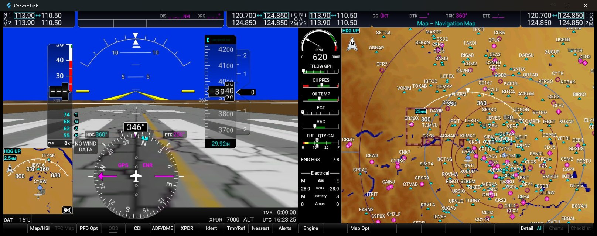
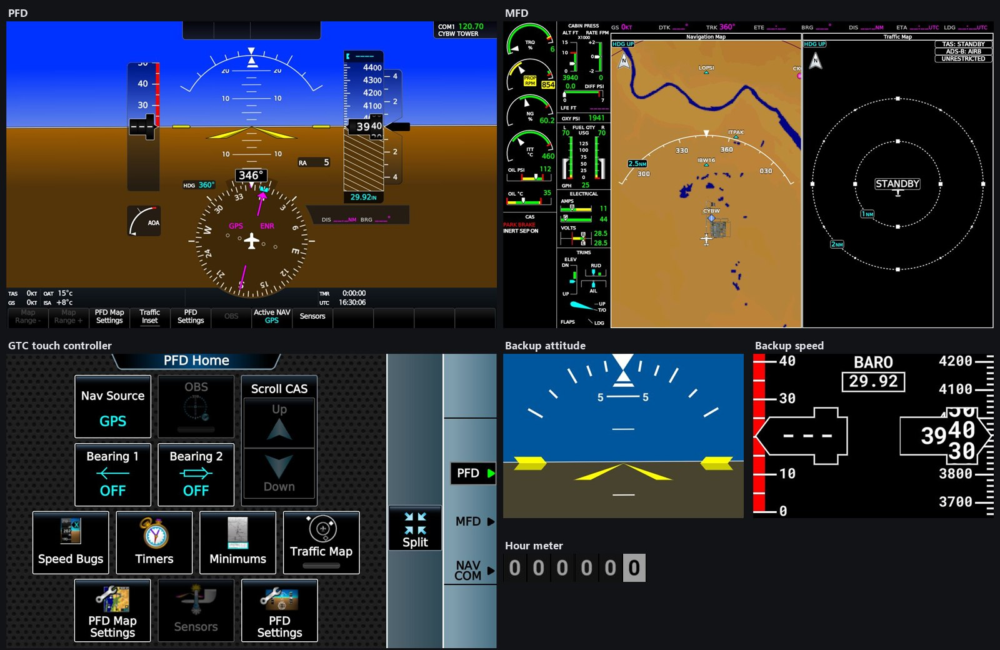
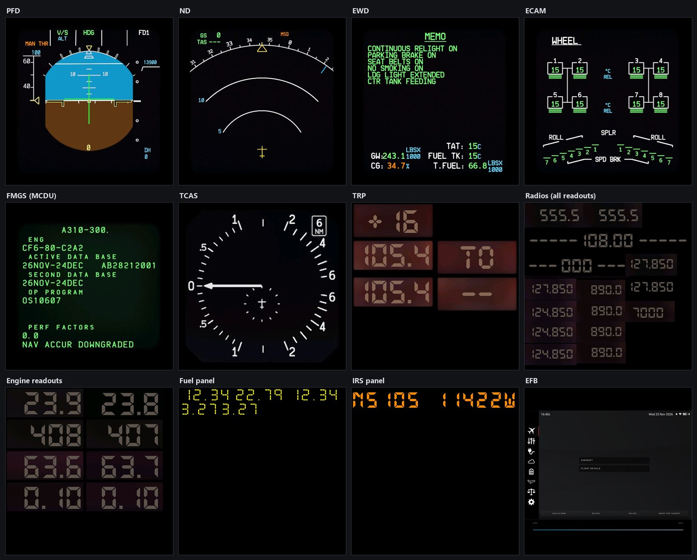
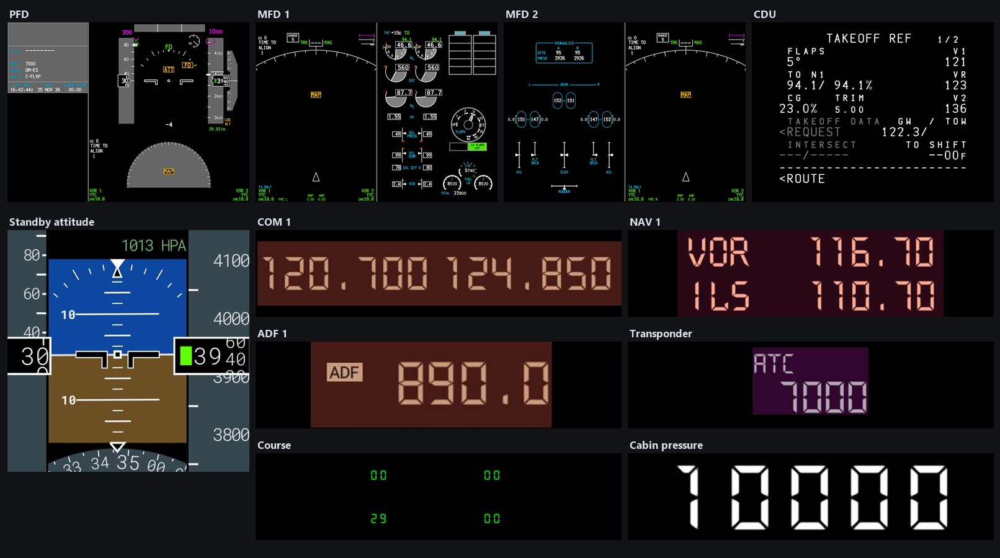
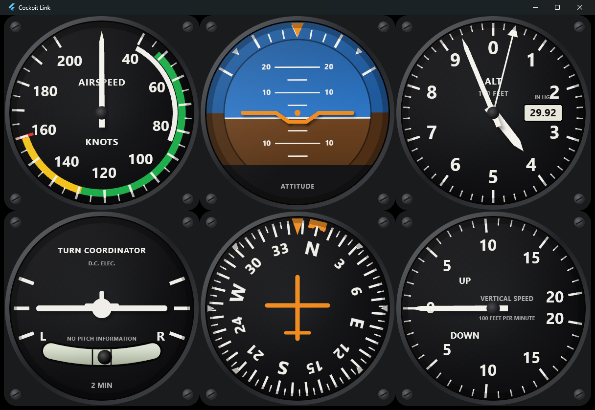
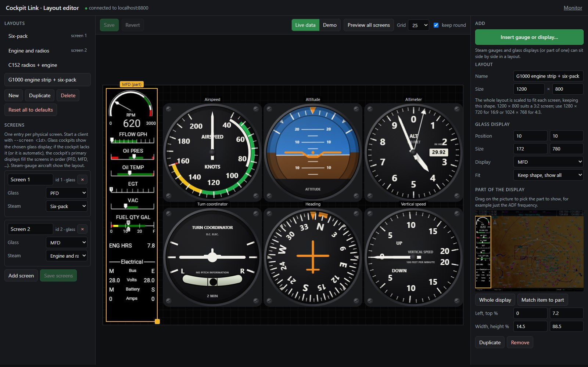
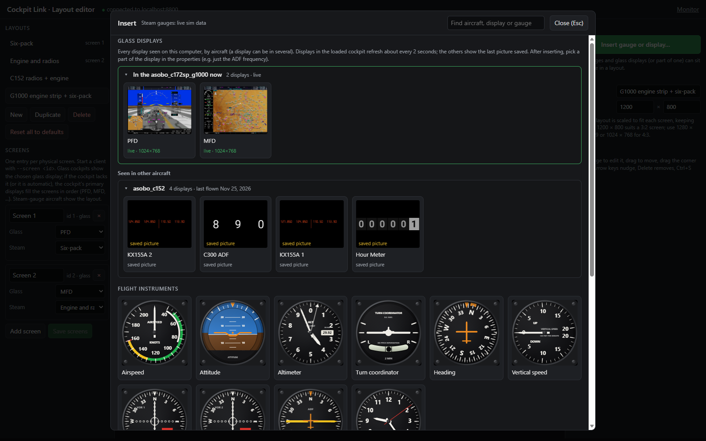
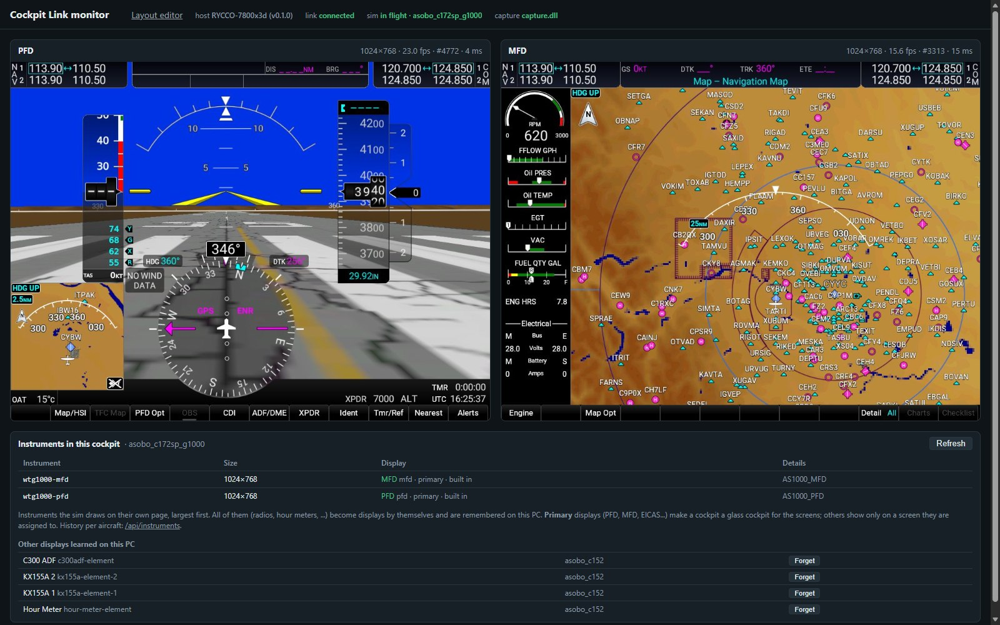

# Screenshots

All taken from the client app and the host's web pages while flying MSFS 2024. Back to the
[README](../README.md).

- [Glass displays](#glass-displays): Cessna 172 G1000, TBM 930, A310, 737 MAX
- [Steam gauges](#steam-gauges)
- [Glass and steam in one layout](#glass-and-steam-in-one-layout)
- [Layout editor](#layout-editor)
- [Monitor page](#monitor-page)

## Glass displays

### Cessna 172 G1000

The PFD and MFD, captured from the sim and shown side by side in the client app.

### TBM 930

Every display of the TBM 930, learned by itself the first time the aircraft was loaded: the G3000 PFD
and MFD, the GTC touch controller, the backup instruments and even the hour meter.

### A310

The A310 airliner, also learned on first load: PFD, ND, the ECAM screens, the MCDU, TCAS and the EFB.
Its radio, engine and panel readouts come as sheets of LCD digits, so any single readout (an ADF
frequency, an N1 value) can be cropped into a layout.

### 737 MAX

26 displays learned on first load. A selection: the PFD, both MFDs, the CDU, the standby attitude
indicator, and some of the small LCDs (radios, transponder, course and cabin pressure), each its own
display that can be put in a layout.

## Steam gauges

Gauge layouts drawn by the client from live sim data: the built-in six-pack and the engine and radios
layout.

| Six-pack | Engine and radios |
|---|---|
|  |  |

## Glass and steam in one layout

The engine strip, cropped from the G1000 MFD, next to steam flight instruments.

## Layout editor

On the host, in a browser: place gauges and glass displays, and pick the part of a display to show.
Here the glass item (the MFD's engine strip) is selected, with the part picker in its properties.

The Insert window lists the displays of the aircraft loaded now, then every display seen before, by
aircraft (here the Cessna 152's radios, ADF and hour meter), followed by all steam gauges.

## Monitor page

What is captured, at what rate, and every instrument in the loaded cockpit.

